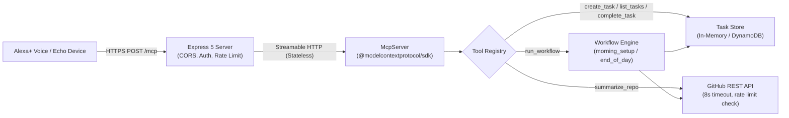

# Alexa TaskFlow

A self-hosted Model Context Protocol (MCP) server that lets Alexa+ run developer workflows by voice. Built for the Amazon "Build, Ship, Shape" Developer Hackathon (Alexa+ track).

---

## What It Is

Alexa TaskFlow exposes a developer task management and repository workflow system to voice assistants using the official Model Context Protocol (spec version 2025-11-25) over stateless Streamable HTTP. 

Using spoken commands, developers can:
- Capture ideas and reminders to their developer task backlog.
- Query open tasks with clean, speakable audio summaries.
- Complete tasks by ID or spoken title substring with automated ambiguity clarification.
- Inspect GitHub repositories for recent commits and open issue counts.
- Trigger morning setup routines and end-of-day retrospectives.

---

## Architecture



---

## Tools

All tools are registered with Zod parameter validation, `readOnlyHint` annotations, and produce speakable, plain-text responses under 300 characters without markdown or emojis:

| Tool | Parameters | Annotations | Description | Spoken Output Example |
| :--- | :--- | :--- | :--- | :--- |
| `create_task` | `title` (string, 1-200 chars) | `readOnlyHint: false` | Adds a task or todo item | *"Added task 1: Fix auth bug. You now have 1 open tasks."* |
| `list_tasks` | `status` (`"open" \| "done" \| "all"`, default `"open"`) | `readOnlyHint: true` | Lists tasks speakably (max 5 items, then "+ N more") | *"You have 2 open tasks: 1, Fix auth bug; 2, Write docs."* |
| `complete_task` | `id` (int, optional), `title` (string, optional) | `readOnlyHint: false` | Completes task by ID or title substring; asks for clarification if ambiguous | *"Completed task 1: Fix auth bug. You have 0 open tasks remaining."* |
| `summarize_repo` | `repo` (format `owner/repo`) | `readOnlyHint: true` | Fetches 3 latest commits and open issues excluding PRs (8s timeout) | *"Repository owner/repo has 14 open issues. Recent commits: Add health check, Fix build script."* |
| `run_workflow` | `name` (`"morning_setup" \| "end_of_day"`), `repo` (optional) | `readOnlyHint: false` | Executes composite developer workflows from an extensible registry | *"Morning setup complete. Created tasks 1 and 2. Repository owner/repo has 5 open issues."* |

---

## Quickstart

### Prerequisites
- Node.js 20+ (`node -v`)
- npm 10+ (`npm -v`)

### Installation & Run

```bash
# Clone and enter the repository
git clone https://github.com/bhadresh/alexa-taskflow.git
cd alexa-taskflow

# Install pinned dependencies
npm install

# Start development server with live reload
npm run dev
```

The server starts on `http://localhost:3000/mcp`.

---

## Voice Demo UI (Simulated Alexa+ Experience)

To test the voice interactions in your browser without hardware:

1. Open your browser to `http://localhost:3000/demo`.
2. Click the microphone button and grant microphone permissions (uses the browser Web Speech API), or type commands into the text input.
3. The demo features:
   - Voice intent router mapping spoken natural language to MCP tool calls.
   - Live transcript panel.
   - Real-time JSON-RPC payload panel.
   - Auto-updating live task dashboard.
   - Spoken audio playback via Web SpeechSynthesis.

---

## Testing with MCP Inspector

You can inspect and debug all tools using the official Model Context Protocol Inspector:

```bash
npm run inspect
```
Or directly:
```bash
npx @modelcontextprotocol/inspector
```

In the Inspector UI:
1. Select **Transport Type**: `Streamable HTTP`.
2. Enter **URL**: `http://localhost:3000/mcp`.
3. Click **Connect**.
4. Test listing tools, inspecting input schemas, and invoking `create_task`, `list_tasks`, and `run_workflow`.

---

## Expose to the Internet with ngrok

Alexa+ requires a publicly accessible HTTPS endpoint with a valid TLS certificate:

```bash
ngrok http 3000
```

- Your public endpoint will be: `https://<your-ngrok-subdomain>.ngrok-free.app/mcp`
- **Important**: When testing from tools that make automated browser-like requests, send the header `ngrok-skip-browser-warning: true` (already included in the server's CORS allow list).

---

## Register Endpoint with Alexa+

Follow the current instructions in the hackathon's **Devpost Resources** tab:

1. In the Alexa+ developer console, register a custom MCP Agent Skill / MCP connection.
2. Set the **Server URL** to your public HTTPS endpoint:
   ```text
   https://<your-host>/mcp
   ```
3. Set the **Authentication** header (if `API_TOKEN` is configured):
   ```text
   Authorization: Bearer <your-api-token>
   ```

---

## Authentication & Security

- **Single-User Design**: Tasks are stored in-memory by default. Single-user developer workflow assumption.
- **Bearer Token Auth**: Set `API_TOKEN` in `.env`. When set, all `POST /mcp` requests require `Authorization: Bearer <token>`.
- **Constant-Time Verification**: Uses `crypto.timingSafeEqual` to protect against timing attacks.
- **Public Endpoints**: `/healthz` and `/demo` remain public for load balancer health probes and demonstration.
- **Payload & Rate Limiting**: 100kb body limit, 60 requests/minute per IP rate limiter returning HTTP 429 with `Retry-After: 60`.
- **Safe Logging**: One-line structured JSON logs measure tool duration without logging bearer tokens or request bodies.

---

## Windows Notes (PowerShell Execution Policy)

On Windows PowerShell, if npm scripts or npx throw an execution policy restriction error (`PSSecurityException`), run:

```powershell
Set-ExecutionPolicy -Scope Process -ExecutionPolicy Bypass
```

Alternatively, invoke commands using `npm.cmd` directly:

```powershell
npm.cmd install
npm.cmd run dev
```

---

## Docker Deployment

Build and run the multi-stage Docker container:

```bash
# Build production image
docker build -t alexa-taskflow .

# Run container on port 3000
docker run -p 3000:3000 --env-file .env alexa-taskflow
```

The container runs as non-root user `nodejs` with a built-in `HEALTHCHECK` probe against `/healthz`.

---

## AWS Deployment (AWS Builder Mini-Challenge)

Alexa TaskFlow supports AWS deployment with zero code changes:
- **Compute**: AWS App Runner or Amazon ECS Fargate with native HTTPS.
- **Storage**: Amazon DynamoDB persistent store (`TASK_STORE=dynamodb`).
- **Secrets**: AWS Secrets Manager for `API_TOKEN`.
- **Infrastructure**: Automated CloudFormation template in [`deploy/aws/cloudformation.yaml`](file:///c:/Users/bhadr/Desktop/AWS%20ALEXA/deploy/aws/cloudformation.yaml).

See the full step-by-step deployment guide in [`deploy/aws/README.md`](file:///c:/Users/bhadr/Desktop/AWS%20ALEXA/deploy/aws/README.md).

---

## Troubleshooting

- **405 on `GET /mcp`**: This is expected behavior per the Streamable HTTP specification. The MCP protocol transport operates statelessly over `POST /mcp`. Use `GET /healthz` for browser health checks.
- **406 Not Acceptable**: Ensure your client sends the header `Accept: application/json, text/event-stream`.
- **CORS Issues**: The server allows `*` origin and responds to preflight `OPTIONS` with `204 No Content`. Set `CORS_ORIGIN` in `.env` if restricting origins.
- **Tunnel Timeouts**: If using ngrok on a free tier, ensure the tunnel is active and verify using `curl http://localhost:3000/healthz`.

---

## Hackathon Details

- **Event**: Amazon "Build, Ship, Shape" Developer Hackathon (October 2026)
- **Track**: Alexa+ Track (Self-Hosted MCP Server, spec 2025-11-25)
- **Mini-Challenges**: AWS Builder (DynamoDB & App Runner integration) & Open Source (MIT License)
- **Author**: Bhadresh
- **License**: MIT (Copyright (c) 2026 Bhadresh)

## ALEXA browser-demo upgrades

The demo now includes optional browser-based “Hey Alexa” listening, local preference memory, time/date commands, website opening, and a help command. See [`NEXT_UPGRADE.md`](./NEXT_UPGRADE.md) for setup, examples, and limitations. Wake-word mode depends on browser Web Speech support and is not an offline always-on listener.
